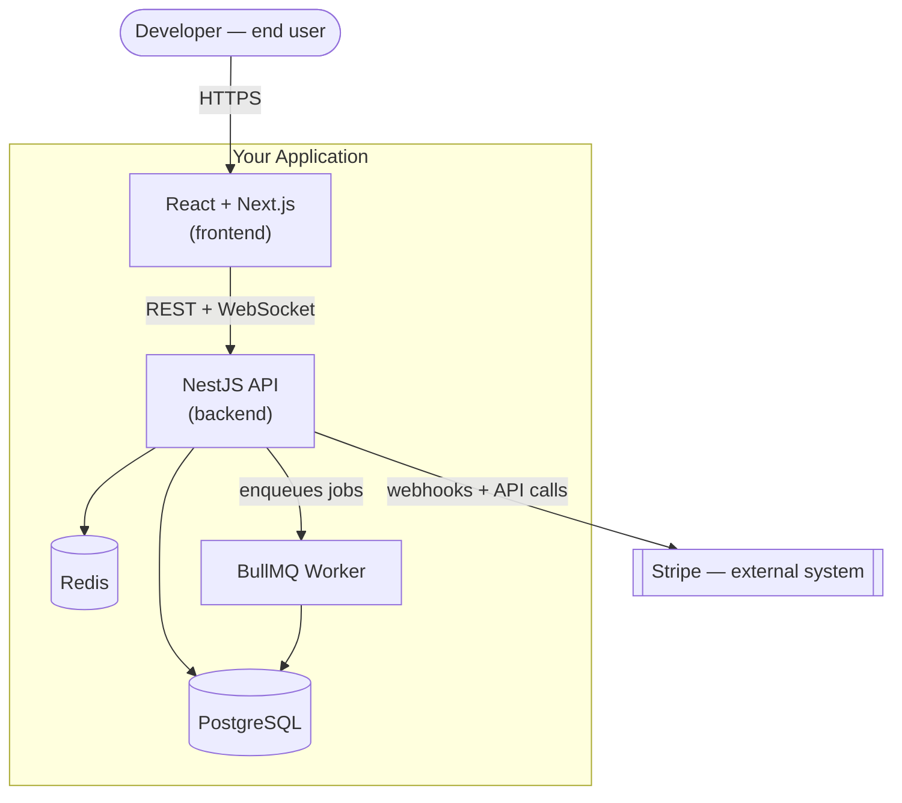
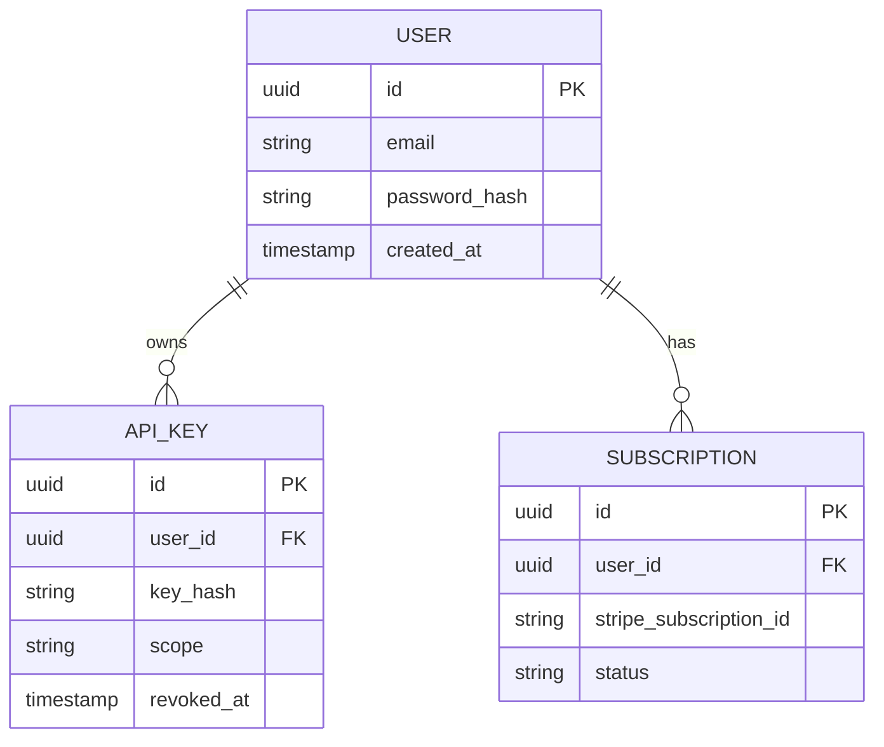
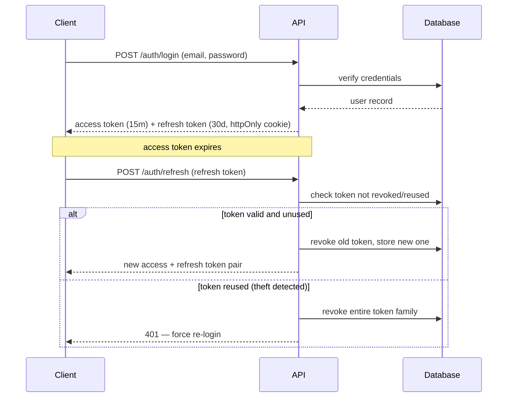

# Project Lifecycle & Planning
### From Idea to Deployed — Requirements, Diagrams, and Running Your Own Sprints

> Every other file in this roadmap teaches you how to build a *piece* well — a component, an endpoint, a query. This file is about the layer above that: how you take a raw idea (yours, a client's, a startup's) and turn it into a scoped, diagrammed, planned, buildable thing — the part senior engineers do *before* the first line of code, and the part that separates "I write good code" from "I can own a project end to end."
>
> **Tier: 🎯 Master.** This isn't optional theory — it's the actual workflow you'll run on every freelance project, every startup idea, every non-trivial feature at a job. It connects directly to material already in this roadmap: MVP scoping uses Lean (Phase 17.2), diagrams feed system design (Phase 10), user stories and ADRs are Phase 16 communication skills, and backlog/sprint practice is the *practical* application of the Agile vocabulary already covered conceptually in Phase 17.1.
>
> **Where this fits:** do a first pass through this file after Phase 3 (Software Design) and before you start the Master Project's build in earnest — you need to *plan* the Master Project using this workflow, not just start typing code. Revisit it at the start of every subsequent real project after that; it should become a reflex, not a one-time read.

---

## Table of Contents
1. [Idea → Requirements](#1--idea--requirements)
2. [The Diagramming Toolkit](#2--the-diagramming-toolkit)
3. [Running Your Own Backlog & Sprints](#3--running-your-own-backlog--sprints)
4. [The Idea → Deployed Checklist](#4--the-idea--deployed-checklist)
5. [Worked Example: The Master Project](#5--worked-example-the-master-project)

---

## 1 — Idea → Requirements

### The 1-Page Brief
Before any diagram, before any backlog, write one page. If you can't fit it on one page, you don't understand the idea well enough yet — that's a real signal, not a formatting rule.

```
PROBLEM       — What's actually broken or missing, for whom, right now?
WHO IT'S FOR  — Be specific. "Developers" is not specific. "Solo indie devs
                who need X but can't justify paying for Y" is specific.
CORE STORIES  — 3-5 user stories max (see below). If you have 15, you
                haven't found the MVP yet.
NON-GOALS     — What you are deliberately NOT building in v1, written down
                explicitly so scope creep has something to argue against.
SUCCESS       — How will you know this actually worked? A number if
                possible ("10 people use it weekly"), not a feeling.
```

### User Stories, Written Properly
Format: **"As a [role], I want [goal], so that [benefit]."** The "so that" is the part people skip, and it's the part that lets you cut a story later if the benefit turns out not to matter.

Every story needs **acceptance criteria** — the concrete, testable conditions that define "this story is actually done" — written in Given/When/Then:

```
Story: As a user, I want to reset my forgotten password, so that I'm not
permanently locked out of my account.

Acceptance criteria:
  Given I click "forgot password" and enter a valid registered email
  When  I submit the form
  Then  I receive a reset link valid for 1 hour, and the old password
        still works until the reset is completed

  Given I click "forgot password" and enter an email that isn't registered
  When  I submit the form
  Then  I see the same generic "check your email" message (never reveal
        whether an email exists — that's a real security requirement,
        not a nitpick, see Phase 14.4 IDOR/enumeration)
```

Notice the second criterion came from *thinking about the story*, not from a checklist — that's the actual skill. Acceptance criteria you write yourself, specifically for this story, catch real edge cases; acceptance criteria copy-pasted from a template don't.

### MVP Scoping
This is where Lean (Phase 17.2) becomes practical instead of conceptual. For every story on your list, ask: *if I cut this, does the core hypothesis still get tested?* If yes, cut it to a "later" list — a real list, not a mental note that quietly becomes "never." A brief with 5 ruthlessly-scoped stories you'll actually finish beats one with 20 you'll abandon at story 8.

---

## 2 — The Diagramming Toolkit

**Use text-based diagrams (Mermaid), not a GUI tool like Lucidchart/draw.io, by default.** A Mermaid diagram lives in your repo as a `.md` file, versions with git, diffs like code, and renders directly in GitHub/most markdown viewers — a GUI diagram is a dead screenshot the moment your schema changes and you forget to update it. Reach for a GUI tool only for a one-off whiteboard-style explanation, not for anything meant to stay accurate over time.

### C4 Model — Architecture, Without Full UML
Four zoom levels, and in practice you'll draw the middle two constantly and the outer two rarely:
- **Context** — your system as one box, plus the humans and external systems around it (rarely drawn in detail for a small project — usually just a sentence).
- **Container** — the actually-deployable pieces (frontend, API, database, cache, worker) and how they talk to each other. **This is the diagram you'll draw for almost every project.**
- **Component** — inside one container, its major internal modules (e.g., inside the NestJS API: Auth module, Billing module, Notifications module). Draw this only when a single container has gotten complex enough that a newcomer would be lost without it.
- **Code** — class-level detail. Almost never worth drawing by hand; if you need this, it's what a class diagram is for, and only for a genuinely complex domain model.

A real Container diagram, for a typical app in this roadmap's stack:



### ERD — Your Database, As a Diagram
Not UML at all, but essential, and you'll draw this before writing a single migration:



Drawing this *before* writing your Prisma schema forces you to think about relationships and cardinality up front — catching "wait, can a user actually have more than one active subscription?" on paper instead of via a migration you have to walk back later.

### Sequence Diagrams — For the Flows That Are Actually Tricky
Don't diagram every endpoint — diagram the ones with real branching or multi-step state, where a paragraph of prose gets confusing. The refresh-token rotation flow from Phase 14.3 is a textbook case:



Once this is drawn, the "detect reuse of a stolen refresh token" requirement from Phase 14.3 stops being an abstract security bullet point and becomes an obvious branch you'd forget to implement if you skipped diagramming it.

### The UML Verdict
Short version, since you asked directly: **skip formal UML as a system.** Two things survive, informally:
- **Sequence diagrams** — genuinely still the best tool for a tricky multi-step flow, as above. Draw them loosely, don't worry about strict UML lifeline notation.
- **Class diagrams** — occasionally, only for a domain model complex enough that prose and an ERD both fall short (rare in typical fullstack CRUD work — most of your "class diagram" needs are actually just an ERD).

Everything else UML offers (use case diagrams, activity diagrams, state machine diagrams, component diagrams, deployment diagrams) has a better modern replacement for fullstack web work: C4 for architecture, ERD for data, and for discovering domain flow/events collaboratively — **Event Storming** (already named in Phase 17.3): sticky notes (physical or a virtual board like Miro/FigJam) with orange = domain events (past tense — `OrderPlaced`), blue = commands, yellow = actors, purple = policies, green = read models, timeline left to right. You can run a lightweight version of this solo, on your own idea, in under an hour, and it produces a better shared mental model than a week of upfront UML ever did.

---

## 3 — Running Your Own Backlog & Sprints

Phase 17.1 already covers what a sprint/story point/retro *is*, conceptually. This is the practical version — how you actually run this alone or on a tiny team, without a Scrum Master doing it for you.

### Pick One Tool and Stop Shopping
**Default recommendation: GitHub Projects.** It's free, lives next to your code, and a task can link directly to the PR that closes it — no context-switching between a separate PM tool and your repo. Linear or Trello are fine if you're working with others who prefer them; the tool matters far less than actually using it consistently.

### Backlog Hygiene
A backlog that only grows and never gets groomed becomes noise you learn to ignore. Weekly (even solo): review it, and for every item either (a) it's still relevant — keep it, (b) it's vague — rewrite it as a real user story, or (c) it's stale — delete it, don't let it rot for six months pretending to be a plan.

### A Solo Sprint, Concretely
1. **Plan (start of cycle, 1-2 weeks)** — pull stories from the backlog you can realistically finish this cycle. Size them loosely — T-shirt sizes (S/M/L) are enough solo; full planning poker needs a room of people disagreeing with each other to be worth the ceremony.
2. **Build** — a simple three-column board (To Do / In Progress / Done) is enough. WIP limit of 1-2 "In Progress" items, even solo — Kanban's actual lesson (Phase 17.1) applies just as much to a team of one.
3. **Retro (end of cycle)** — write it down, even three bullet points: what went well, what didn't, one concrete change for next cycle. The value is in the writing, not the length — a retro you don't write is a retro that didn't happen.

### Definition of Done
Write your own, once, and reuse it — a story isn't "done" just because the happy path works:
```
- Code written and it does what the acceptance criteria describe
- Tests exist for it (Phase 11) and pass
- No secrets/credentials committed (Phase 14.8)
- Error cases handled, not just the happy path
- Deployed (Phase 13) or merged to the branch that will be
```

---

## 4 — The Idea → Deployed Checklist

The full sequence, in order, tying sections 1-3 together:

1. Write the 1-page brief + 3-5 user stories with acceptance criteria (§1).
2. Write your non-goals explicitly — what v1 is *not* (§1).
3. Draw the C4 Container diagram — the pieces and how they talk (§2).
4. Draw the ERD — your data model, before your migrations (§2).
5. Draw sequence diagrams for the 1-2 genuinely tricky flows (§2).
6. Break stories into small backlog tasks in your tracker (§3).
7. Plan your first cycle — pick what you'll actually finish (§3).
8. Build — following the relevant phases in this roadmap and the matching milestones in `Projects_And_Practice.md`.
9. Deploy early, even a rough version — a live, ugly v1 beats a polished thing that only runs on `localhost` (Phase 13's trimmed scope is explicitly fine here: a single EC2 instance or a PaaS like Railway/Render/Fly.io).
10. Retro, update the brief/backlog with what you learned, repeat from step 6 for the next cycle.

---

## 5 — Worked Example: The Master Project

Applying this to the SaaS platform from `Master_Senior_Fullstack_Roadmap.md`:

**Brief (condensed):**
```
PROBLEM      — Developers building side projects/startups need auth,
               billing, and background jobs wired up correctly every
               time, and keep rebuilding the same boilerplate badly.
WHO          — Solo devs and small teams shipping a new SaaS idea.
CORE STORIES — Sign up & log in securely; generate/revoke scoped API
               keys; get real-time usage notifications; search my own
               documents; get billed correctly on a subscription.
NON-GOALS    — No team/org accounts in v1. No custom billing plans —
               one flat subscription tier only, for now.
SUCCESS      — I can hand this repo to another developer and they
               understand the architecture from the code and diagrams
               alone, in under 15 minutes.
```

The Container diagram and refresh-token sequence diagram in §2 above **are** the real diagrams for this project, not just examples — reuse them directly. The ERD in §2 is the starting core (`USER`, `API_KEY`, `SUBSCRIPTION`) — extend it as you add usage analytics and RAG search tables.

From here, the backlog is just the Master Project's build order from `Projects_And_Practice.md`, turned into GitHub Projects cards: one card per numbered step (Core API, Frontend, Testing, Infra, Advanced backend, Deploy, Monitoring, AI feature, Billing, Security pass, Track B rebuild) — broken further into the smaller stories each step actually contains. You already have the backlog; this file is what turns it into something you plan and run cycle by cycle, instead of a wall of text you build against in a random order.
